# Knowledge Manager

一个跑在本机的 RAG 知识库问答系统。文档进来，答案出去，中间隔着的东西比"向量搜索 + 大模型"要多一些：
提问先分诊再规划检索、检索结果过交叉编码器重排、重复提问走三层缓存、摘要由 agent 自己决定读哪几段。

设计上只盯三件事：**该召回的片段能召回**、**答案落到具体文档上**、**同样的问不重复付钱**。
所有阈值都是在这台机器上实测标定出来的，不是拍的。

## 目录

- [核心特性](#核心特性)
- [界面](#界面)
- [技术栈](#技术栈)
- [系统架构](#系统架构)
- [快速开始](#快速开始)
- [配置项](#配置项)
- [主要接口](#主要接口)
- [目录结构](#目录结构)
- [问答链路：一次提问到底发生了什么](#问答链路一次提问到底发生了什么)
- [检索：召回、重排、去重、补全](#检索召回重排去重补全)
- [问答缓存：三层命中](#问答缓存三层命中)
- [摘要 Agent：为什么值得用工具循环](#摘要-agent为什么值得用工具循环)
- [前端](#前端)
- [测试与评测](#测试与评测)
- [常见问题](#常见问题)
- [安全提示与已知限制](#安全提示与已知限制)
- [服务器部署（可选）](#服务器部署可选)
- [开发约定](#开发约定)
- [License](#license)

## 核心特性

| 能力 | 做法 | 实测 |
|------|------|------|
| 多格式解析 | PDF / DOCX / DOC / MD / TXT / CSV / LOG / JSON，PDF 按页提取，DOC 走 Windows COM 兜底 | — |
| 语义检索 | BGE-M3 稠密向量 + Milvus HNSW，文件名/标题参与嵌入 | 向量化 ~0.2s/篇，端到端（含摘要）~5s/篇 |
| 文件名命中 | 名称相似度参与打分，按**覆盖度打折**，避免共享前缀的文档抢位 | 4/8 字共享从 0.90 降到 0.70 |
| 交叉编码器重排 | 检索阶段用 bge-reranker-large 重排前 12 条，低置信度时保持向量序 | 12 条约 0.4s（单条 ~35ms） |
| 相邻片段补全 | 命中片段前后补 2~3 块，标注 `neighbor` 不参与打分 | 段落不再半句截断 |
| 重复文档降权 | 字符 3-gram Jaccard ≥ 0.6 判重，副本分数打 5 折 | 117/118 一对重复，其余章节 0.15~0.39 不误判 |
| 问答缓存 | 分层：精确指纹 → 词面 → 语义+重排，全部带守卫 | 9063ms → **73ms** |
| 检索规划 | direct / hyde / decompose 三选一，同时判断 kb / general | 通用问题从"只有简历"到 1819 字分层答案 |
| 先分诊后作答 | 寒暄/身份/能力类问题规则命中，直接回固定话术 | 21s → **0.05s** |
| 生成后自检 | 引用越界、句子复读、跨文档拼接时重写一次 | 触发率低，但能兜住 |
| 摘要 Agent | ReAct 工具循环，自己决定读哪几段 | 17 块文档，不确定路径 19s vs 固定 2s |

## 界面

> 截图取自本机知识库（70 篇文档 / 2718 个分块），全部是真实运行结果。

| | |
|:--:|:--:|
| 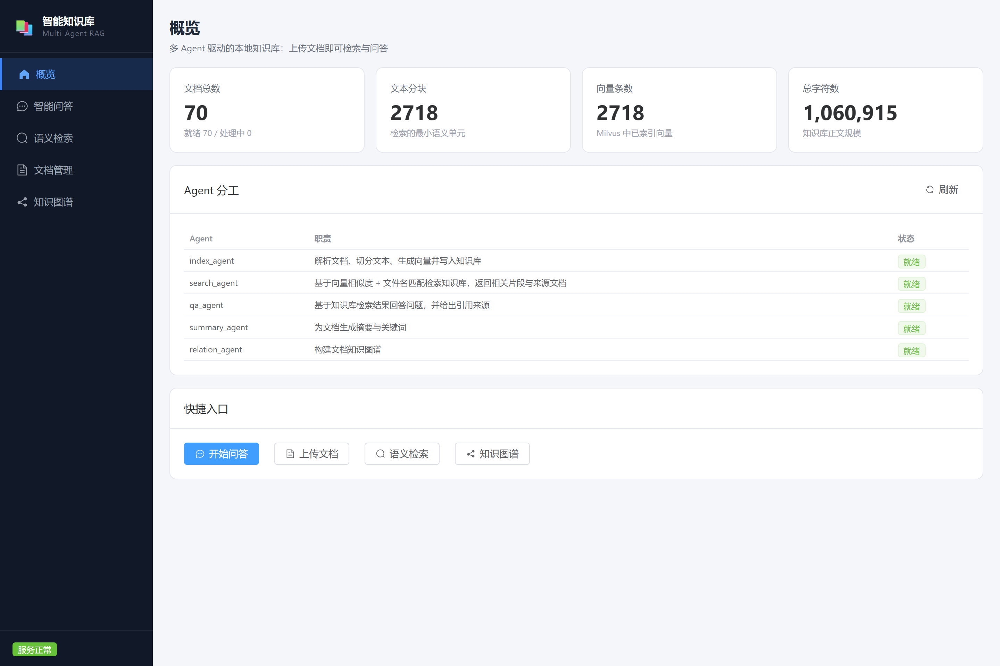 | 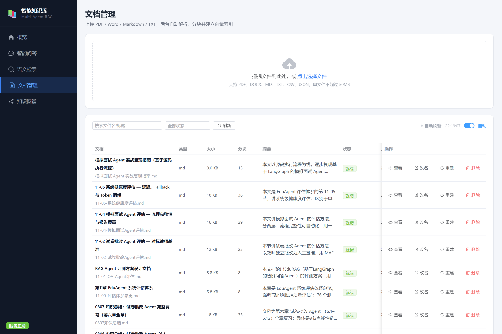 |
| **概览**：规模统计与五个 Agent 的状态 | **文档管理**：拖拽上传、状态轮询、摘要预览 |
| 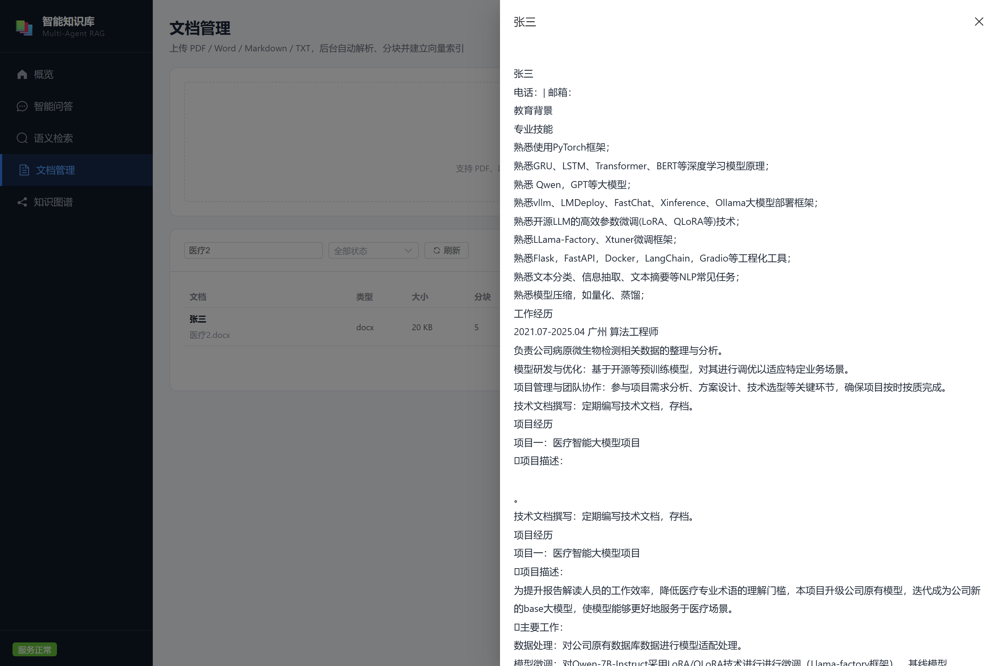 | 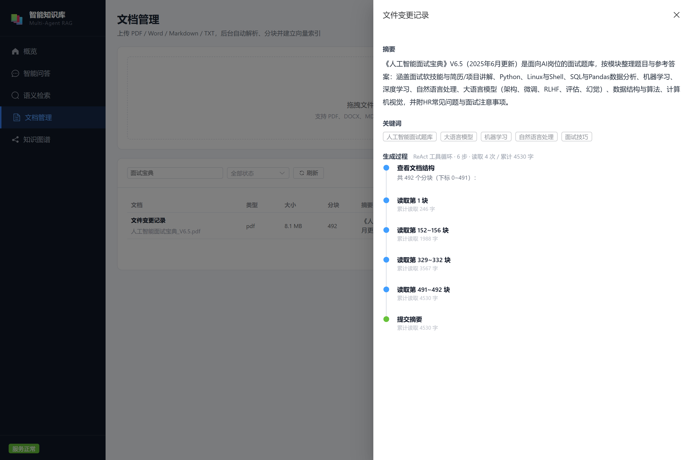 |
| **正文预览**：分块与索引之前的原文 | **摘要与决策轨迹**：ReAct 读了哪几块、累计多少字 |
| 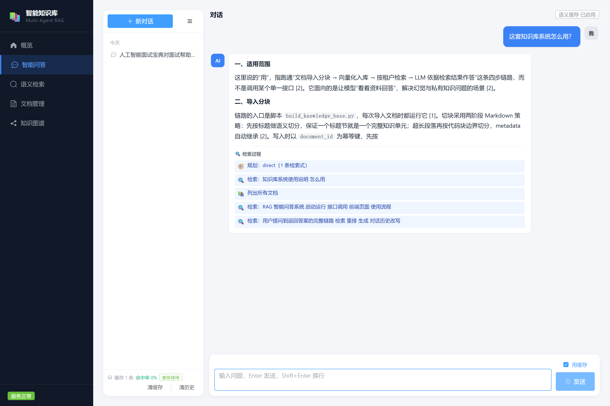 | 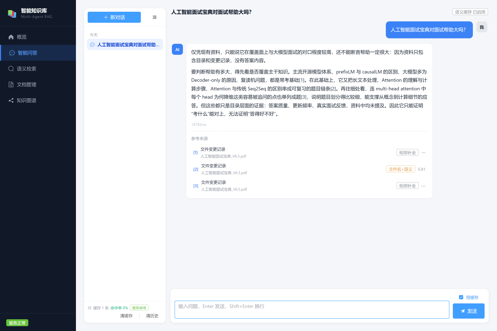 |
| **检索过程**：规划 → 检索 → 列文档，边查边显示 | **回答**：结论在前，引用标出匹配方式 |
| 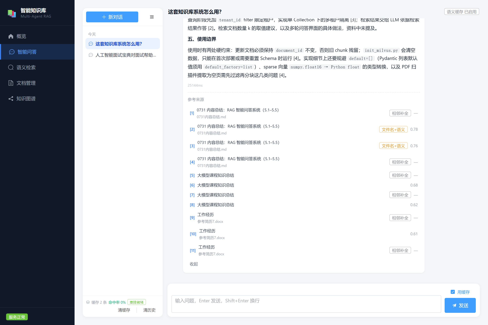 | 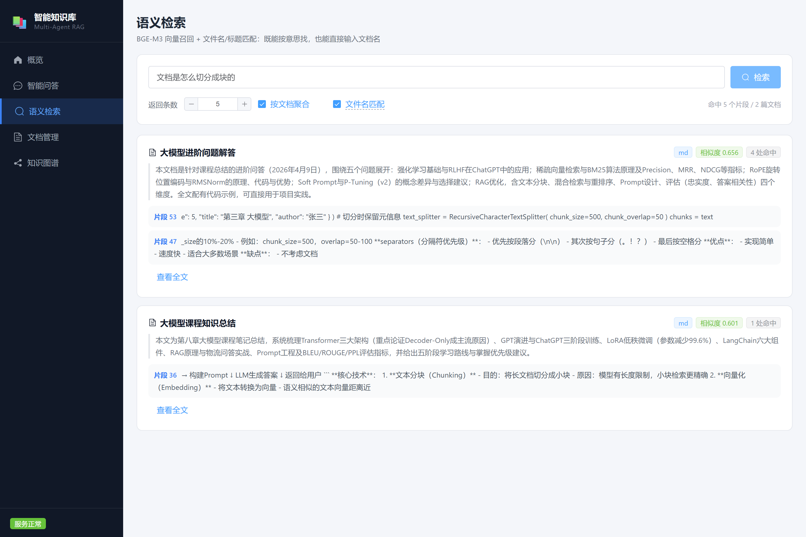 |
| **引用折叠**：默认 4 条，点开展开全部 | **语义检索**：按文档聚合，标相似度与命中片段 |
| 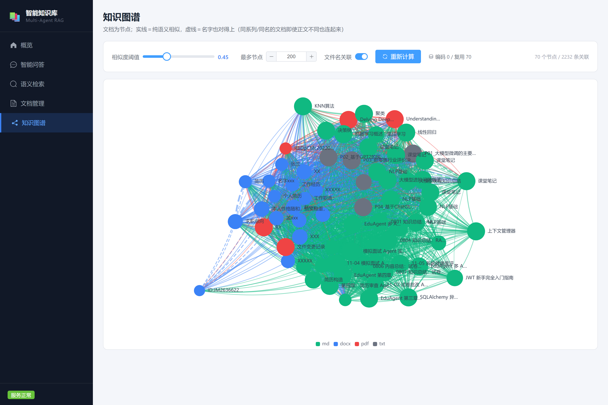 | 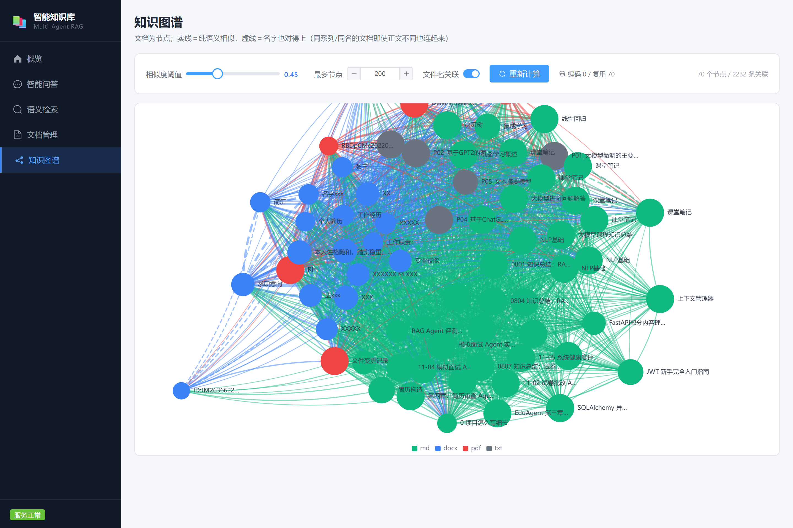 |
| **知识图谱**：实线是语义相似，虚线是名字对得上 | **缩放**：滚轮放大，看清簇内关系 |
| 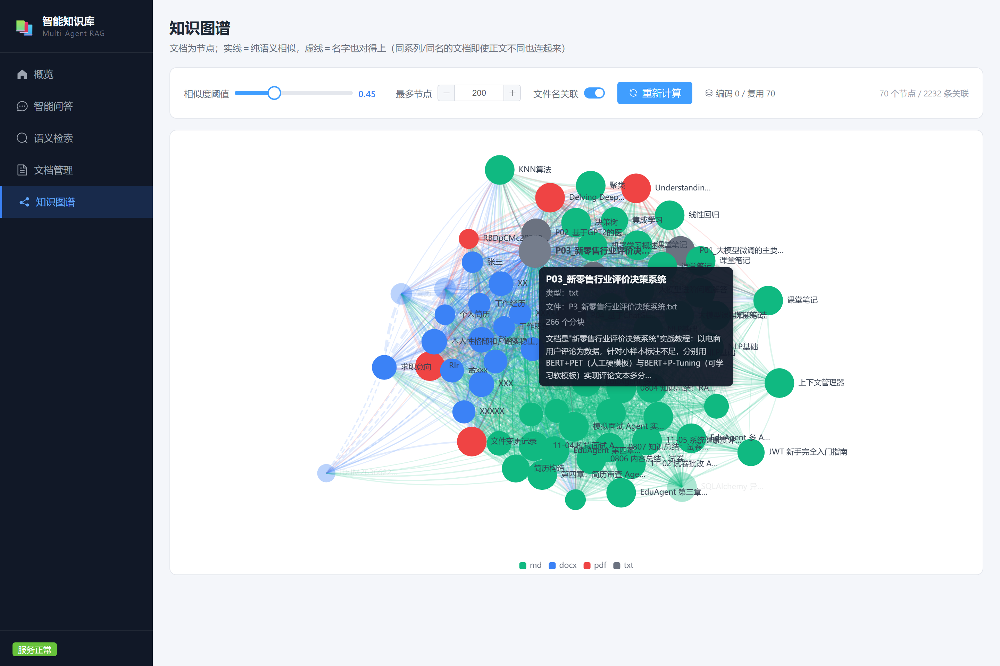 | |
| **悬停详情**：类型、分块数、文档摘要 | |

## 技术栈

| 层 | 选型 |
|----|------|
| 后端 | Python 3.10+ / FastAPI / Uvicorn / Pydantic v2 |
| 前端 | Vue 3 + Vite + Element Plus + ECharts（图谱） |
| 向量库 | Milvus 2.4（HNSW，COSINE） |
| 关系库 | MySQL 8（文档、分块、缓存、会话） |
| 嵌入 | BGE-M3（1024 维，支持长文本） |
| 重排 | bge-reranker-large（交叉编码器） |
| 大模型 | DeepSeek（OpenAI 兼容协议，可换任意同协议服务） |
| 分词 | jieba（中文 BM25 与缓存词面匹配） |
| 部署 | docker compose（Milvus 依赖 etcd + MinIO） |

## 系统架构

```
浏览器
  │  /api/v1/*
  ▼
FastAPI ──┬── documents  上传 → 解析 → 切块 → 嵌入 → Milvus
          ├── qa         分诊 → 规划 → 检索 → 作答
          ├── graph      文档向量缓存 + 文件名关联边
          ├── cache      缓存统计与清理
          └── system     健康检查 / 统计 / Agent 状态
                 │
     ┌───────────┼────────────┐
     ▼           ▼            ▼
   MySQL       Milvus      DeepSeek API
 (元数据)    (向量检索)    (生成/规划/摘要)
```

**模块职责**

| 目录 | 负责 | 关键文件 |
|------|------|----------|
| `app/api/` | 路由与请求校验 | `qa.py` / `documents.py` |
| `app/agents/` | 五类 Agent | `qa_agent.py` / `summary_agent.py` |
| `app/services/` | 业务逻辑：解析、切块、嵌入、检索、缓存、重排、LLM | `retrieval_service.py` / `qa_cache_service.py` |
| `app/utils/` | 分词、文件名匹配、文本切分 | `chinese_tokenizer.py` / `name_matcher.py` |
| `app/models/` | ORM | `document.py`（含 Chunk）/ `qa_cache.py` |
| `app/db/` | 引擎、会话、建表、幂等补列 | `database.py` |

**Agent 分工**

| Agent | 形态 | 说明 |
|-------|------|------|
| `IndexAgent` | 固定流程 | 解析 → 切块 → 嵌入 → 写 Milvus，失败可重试 |
| `SearchAgent` | 固定流程 | 单次检索（向量 + 文件名加分 + 重排 + 去重） |
| `QAAgent` | ReAct + 规划 | 先分诊再规划，证据不足才进工具循环 |
| `SummaryAgent` | ReAct | 四个工具，自己决定读哪几段 |
| `RelationAgent` | 固定流程 | 文件名相似度连边，构建知识图谱 |

### 提问链路

1. **分诊**（0ms）：寒暄、身份、能力、致谢、告别 → 固定话术，不检索不带引用
2. **规划**（~1s）：`direct` / `hyde` / `decompose`，同时判 `scope`（kb / general / mixed）
3. **检索**（~0.5s）：向量召回 → 文件名加分 → 交叉编码器重排 → 去重降权 → 相邻补全
4. **早退判定**：规划为 direct、最高分 ≥0.72、片段 ≥4、非对比列举 → 跳过工具循环
5. **工具循环**（0~2 轮）：换措辞重搜、读原文、按文件名定位，无新增片段即停
6. **提纲**（~1s）：多段答案先列骨架，避免"每段都对、放一起没逻辑"
7. **作答 + 自检**（~5s）：流式输出；引用越界/复读/跨文档拼接时重写一次
8. **落缓存**：完整答案 + 知识库签名，任何文档变更自动失效

## 快速开始

### 环境要求

- Windows 10/11（项目在 Windows 上开发和测试；Linux/macOS 可跑后端）
- Python 3.10+、Node.js 18+、Docker Desktop（起 Milvus 和 MySQL）
- 可选：NVIDIA 显卡（8GB 显存可跑 BGE-M3 + 重排；CPU 也能跑，慢 5~10 倍）

### 1. 起依赖

```bash
docker compose -f docker-compose.dev.yml up -d
docker compose -f docker-compose.dev.yml ps   # 等 milvus-standalone 变 healthy
```

只起 MySQL（宿主 3307）和 Milvus（19530）。Milvus 依赖 etcd + MinIO，冷启动 30~60 秒。

### 2. 放模型

`models/bge-m3`（必填）与 `models/bge-reranker-large`（可选，缺了自动降级），从 HuggingFace
或镜像站下载后按这个目录放。模型路径可以用 `BGE_MODEL_PATH` 改到任意位置。

### 3. 配环境变量

复制 `.env.example` 为 `.env.local`，至少填 `DEEPSEEK_API_KEY=sk-...`（已在 `.gitignore` 中）。
其余变量都有默认值，见[配置项](#配置项)。

### 4. 后端

```powershell
cd backend
python -m venv venv
.\venv\Scripts\activate
pip install -r requirements.txt
.\venv\Scripts\python.exe check_env.py     # 依赖 / 模型 / MySQL / Milvus / API Key 自检
```

看到 `SUCCESS | 全部检查通过` 再启动：

```powershell
.\venv\Scripts\python.exe -m uvicorn app.main:app --reload --reload-dir app --host 127.0.0.1 --port 8000
```

> `--reload-dir app` 要带上。不加的话 uvicorn 会盯着整个 `backend/`，改 `tests/` 里的脚本也会触发重启。

仓库根目录也提供了 `start-backend.bat` / `start-frontend.bat` / `stop-servers.bat`，等价于上面两条命令。

### 5. 前端

```powershell
cd frontend
npm install
npm run dev
```

打开 <http://localhost:3000>，API 文档在 <http://127.0.0.1:8000/api/v1/docs>。首次启动会加载
BGE-M3（20~60 秒），日志出现 `嵌入模型预热完成` 再去传文档；重排模型后台加载，不阻塞。

## 配置项

全部在 `backend/app/config.py` 的 `Settings`，用同名大写下划线环境变量覆盖。
优先级：类默认值 < env 文件 < `config.override.json` < 系统环境变量。

### 基础与模型

| 变量 | 默认值 | 说明 |
|------|--------|------|
| `ENVIRONMENT` / `DEBUG` | `development` / `true` | 生产环境关掉调试行为与 reload |
| `API_PREFIX` | `/api/v1` | 接口前缀 |
| `HOST` / `PORT` | `0.0.0.0` / `8000` | 监听地址 |
| `CORS_ORIGINS` | `["http://127.0.0.1:3000","http://localhost:3000"]` | 跨域白名单 |
| `BGE_MODEL_PATH` | `<root>/models/bge-m3` | 嵌入模型目录 |
| `BGE_DEVICE` | `cuda` | 改 `cpu` 也能跑 |
| `BGE_BATCH_SIZE` | `16` | 显存紧就调到 8 / 4 |
| `BGE_MAX_LENGTH` | `1024` | 单块最大 token |
| `DEEPSEEK_API_KEY` | 空 | **必填** |
| `DEEPSEEK_BASE_URL` | `https://api.deepseek.com` | 换 OpenAI 兼容服务改这里 |
| `DEEPSEEK_MODEL` | `deepseek-chat` | 也可 `deepseek-reasoner` |
| `LLM_TEMPERATURE` / `LLM_MAX_TOKENS` | `0.3` / `2048` | 推理类模型要给思维链留预算 |

### 存储与分块

| 变量 | 默认值 | 说明 |
|------|--------|------|
| `MYSQL_HOST/PORT/USER/PASSWORD/DATABASE` | `127.0.0.1` / `3307` / `root` / `root` / `knowledge_manager` | 库不存在自动建 |
| `MILVUS_HOST/PORT/COLLECTION` | `127.0.0.1` / `19530` / `km_chunks` | 集合与索引自动建 |
| `DOCUMENTS_PATH` / `UPLOAD_PATH` | `<root>/data/documents`、`<root>/data/uploads` | |
| `CHUNK_SIZE` / `CHUNK_OVERLAP` | `500` / `80` | 按字符切 |

### 检索

| 变量 | 默认值 | 说明 |
|------|--------|------|
| `SEARCH_TOP_K` | `5` | 向量召回条数 |
| `SCORE_THRESHOLD` | `0.35` | 低于该分直接丢弃；0 会把噪声全放进上下文 |
| `EMBED_WITH_NAME` | `true` | 文件名/标题拼进待嵌入文本 |
| `FILENAME_MATCH_THRESHOLD` | `0.45` | 名称相似度达到即算命中，参与加分 |
| `FILENAME_STRONG_THRESHOLD` | `0.75` | 强命中保底入选；只给整名基本命中的文档 |
| `FILENAME_BOOST` | `0.20` | 命中加分上限，按覆盖度打折 |
| `GRAPH_NAME_EDGE_THRESHOLD` | `0.6` | 图谱里文件名关联边的连边阈值 |
| `RETRIEVAL_RERANK_ENABLED` | `true` | 检索阶段交叉编码器重排 |
| `RETRIEVAL_RERANK_CANDIDATES` / `RETRIEVAL_RERANK_MIN_CONFIDENT` | `12` / `0.5` | 重排候选数；最高分低于 0.5 则保持向量序 |
| `RETRIEVAL_RERANK_BATCH_SIZE` | `8` | 一次前向的批大小，太大爆显存 |
| `RETRIEVAL_DEDUP_ENABLED` / `RETRIEVAL_DEDUP_PENALTY` | `true` / `0.5` | 近重复文档降权，副本分数打 5 折 |
| `RETRIEVAL_DEDUP_FILE` | `<root>/backend/data/doc_duplicates.json` | 判重映射，由脚本生成 |

### 问答 Agent

| 变量 | 默认值 | 说明 |
|------|--------|------|
| `QA_AGENT_ENABLED` | `true` | 总开关，`false` 退回单次检索 |
| `QA_AGENT_MAX_STEPS` | `2` | 证据收集最多几轮 LLM 往返；某轮无新片段提前停 |
| `QA_AGENT_SCORE_GATE` | `0.55` | 单次检索最高分低于此值升级为 agent（`QA_AGENT_ALWAYS=true` 时忽略） |
| `QA_AGENT_ALWAYS` | `true` | 实质性问题一律走循环，用延迟换质量 |
| `QA_AGENT_EARLY_EXIT_ENABLED` / `QA_AGENT_EARLY_EXIT_SCORE` / `QA_AGENT_EARLY_EXIT_CHUNKS` | `true` / `0.72` / `4` | 证据够了就跳过循环：命中分 ≥0.72 且片段 ≥4 条 |
| `QA_QUERY_PLAN_ENABLED` | `true` | 作答前先规划检索策略 |
| `QA_HYDE_MAX_TOKENS` | `220` | 「假设答案」的生成预算 |
| `QA_LOW_RELEVANCE_GATE` | `0.58` | 最高分低于此值，提示词里提示"相关度低" |
| `QA_ANSWER_FLOOR` | `0.40` | 低于此值直接回固定话术，不调模型 |
| `QA_REVIEW_ENABLED` | `true` | 生成后自检，命中则重写一次 |
| `QA_OUTLINE_ENABLED` / `QA_OUTLINE_MAX_TOKENS` | `true` / `320` | 多段答案先列提纲 |
| `QA_TOOL_TRANSPORT` | `local` | `local` 直调 / `mcp` 走协议（实验性） |

### 问答缓存

| 变量 | 默认值 | 说明 |
|------|--------|------|
| `QA_CACHE_ENABLED` | `true` | 总开关 |
| `QA_CACHE_SIMILARITY_THRESHOLD` | `0.85` | 词面 IDF 加权余弦阈值 |
| `QA_CACHE_MIN_CONFIDENCE` / `QA_CACHE_TEMPERATURE` | `0.25` / `1.0` | softmax 置信度下限（在 top_k 上算）与温度 |
| `QA_CACHE_TOP_K` | `8` | 词面通道召回条数 |
| `QA_CACHE_TTL_DAYS` / `QA_CACHE_MAX_ENTRIES` | `7` / `2000` | 过期时间与上限（超了淘汰最旧） |
| `QA_CACHE_MIN_QUESTION_LEN` | `4` | 太短的问题不缓存 |
| `QA_CACHE_SEMANTIC_RECALL` / `QA_CACHE_SEMANTIC_TOP_K` | `0.70` / `5` | 语义通道**召回**阈值（不用于判定）与条数 |
| `QA_RERANKER_ENABLED` | `true` | 关掉只用前两层 |
| `QA_RERANKER_PATH` | `<root>/models/bge-reranker-large` | 重排模型目录 |
| `QA_RERANK_THRESHOLD` / `QA_RERANK_CANDIDATES` | `0.995` / `3` | 语义最终判定阈值；每题最多重排几条（每条 ~35ms） |
| `QA_RERANKER_MAX_LENGTH` | `512` | 段落重排需要更长输入，128 会截掉关键句 |

### 历史对话

| 变量 | 默认值 | 说明 |
|------|--------|------|
| `HISTORY_MAX_CONVERSATIONS` / `HISTORY_MAX_MESSAGES` | `200` / `200` | 会话数与单会话消息上限 |
| `HISTORY_CONTEXT_ROUNDS` / `HISTORY_CONTEXT_CHARS` | `3` / `400` | 追问带几轮上下文（0 表示不带）与每轮截断长度 |

## 主要接口

完整文档：<http://127.0.0.1:8000/api/v1/docs>

| 方法 | 路径 | 说明 |
|------|------|------|
| POST | `/api/v1/documents/upload` | 上传文档，后台异步索引 |
| GET | `/api/v1/documents` | 列表（分页 / 状态筛选 / 名称搜索） |
| GET | `/api/v1/documents/{id}` | 详情 |
| GET | `/api/v1/documents/{id}/content` | 正文预览 |
| GET | `/api/v1/documents/{id}/summary-trace` | 摘要 Agent 决策轨迹 |
| PATCH | `/api/v1/documents/{id}` | 改名/改标题，即时重算向量 |
| DELETE | `/api/v1/documents/{id}` | 删向量 + 记录 + 磁盘文件 |
| POST | `/api/v1/documents/{id}/reindex` | 重新索引 |
| POST | `/api/v1/qa/search` | 语义检索（不生成） |
| POST | `/api/v1/qa` | 问答，一次性 JSON |
| POST | `/api/v1/qa/stream` | 问答，SSE 流式 |
| GET | `/api/v1/graph` | 知识图谱，支持 `min_score` |
| GET/DELETE | `/api/v1/graph/vector-cache` | 文档向量缓存概况 / 清空 |
| GET | `/api/v1/cache/stats` | 缓存统计（含重排模型状态） |
| GET | `/api/v1/cache` | 缓存条目列表 |
| DELETE | `/api/v1/cache` | 清空缓存 |
| GET | `/api/v1/conversations` | 会话列表 |
| POST | `/api/v1/conversations` | 新建会话 |
| GET | `/api/v1/conversations/{id}` | 会话详情（含消息） |
| PATCH/DELETE | `/api/v1/conversations/{id}` | 重命名 / 删除 |
| DELETE | `/api/v1/conversations` | 清空全部会话 |
| GET | `/api/v1/health` | 健康检查 |
| GET | `/api/v1/health/detail` | 依赖健康（MySQL / Milvus / LLM / 嵌入） |
| GET | `/api/v1/stats` | 知识库统计 |
| GET | `/api/v1/agents` | Agent 列表与状态 |

### 流式事件

| 事件 | 时机 | 数据 |
|------|------|------|
| `meta` | 请求开始 | `cached` / `conversation_id` / `steps` / `degraded` |
| `step` | 每个工具调用 | `step` / `tool` / `args` / `summary` |
| `delta` | 生成中 | `{ "text": "…" }` |
| `replace` | 自检重写后 | `{ "text": "完整答案" }`，前端整体替换初稿 |
| `error` | 异常 | `{ "message": "…" }` |
| `done` | 结束 | `latency_ms` / `conversation_id` |

```bash
curl -N -X POST http://127.0.0.1:8000/api/v1/qa/stream \
  -H "Content-Type: application/json" \
  -d '{"question":"文档是怎么切分成块的","save_history":false}'
```

## 目录结构

```
agentuse/
├── backend/
│   ├── app/
│   │   ├── agents/          # Index / Search / QA / Summary / Relation
│   │   ├── api/             # documents / qa / graph / cache / conversations / system
│   │   ├── db/ models/      # 引擎、建表、ORM
│   │   ├── services/        # 解析、切块、嵌入、Milvus、检索、缓存、重排、LLM
│   │   ├── utils/           # 分词、文件名匹配、文本切分
│   │   └── mcp_server.py    # MCP server（把检索工具暴露给外部宿主）
│   ├── tests/               # 14 个验证/评测脚本
│   └── check_env.py / evaluate_*.py / measure_index.py
├── frontend/src/            # views / api / router
├── data/ models/            # 运行时数据与模型权重，均不入库
├── scripts/                 # find_duplicate_docs.py / free-ports.ps1
├── docs/问题与修复记录.md    # 踩过的坑与根因
└── docker-compose.dev.yml / docker-compose.prod.yml
```

## 问答链路：一次提问到底发生了什么

```
问题
 ├─ ① 分诊（正则，0ms）── 寒暄/身份/能力/致谢/告别 ─→ 固定话术，结束
 ├─ ② 规划（1 次 LLM，~1s）─→ direct / hyde / decompose + scope(kb/general/mixed)
 ├─ ③ 检索（~0.5s）向量召回 + 文件名加分 + 重排 + 去重 + 相邻补全
 ├─ ④ 早退?（direct + ≥0.72 + ≥4 片段 + 非对比类）── 是 ─→ 跳到 ⑥
 ├─ ⑤ 工具循环（0~2 轮）换措辞重搜 / 读原文 / 按文件名定位；无新增即停
 ├─ ⑥ 提纲（~1s，多段答案才触发）
 ├─ ⑦ 作答（流式）+ 自检（引用越界/复读/跨文档 → 重写一次）
 └─ ⑧ 落缓存（答案 + 知识库签名）
```

### ① 分诊：先决定要不要花钱

"hi，你好" 走完整链路要 5 次模型往返（规划 → 检索 → 循环 → 提纲 → 作答），实测 21 秒；
"你是谁呀？" 25 秒。这类输入没有"知识库内容"可查，检索只会翻出无关片段，再用长篇解释它们。

`collect()` 最前面加了一层纯规则分诊：长度 ≤12 字 + 正则整句匹配才命中，命中直接回固定话术，
不检索、不生成、不带引用。只认"整句就是寒暄"：超过 12 字或带具体指代的
（"你好，帮我看看这份简历"）一律走正常链路。**规则够用就不上模型**——多一次意图分类调用，
反而把延迟加了回去。

| 意图 | 示例 | 耗时 |
|------|------|------|
| greeting | hi、你好、早上好 | ~0.05s |
| identity | 你是谁、介绍一下你自己 | ~0.05s |
| capability | 你能做什么、有什么功能 | ~0.05s |
| thanks / bye | 谢谢、辛苦了、再见 | ~0.05s |

### ② 规划：从"怎么问"到"怎么查"

问句本身不一定是好的检索词。作答前让模型做一次小规划：

| 策略 | 什么时候用 | 怎么做 |
|------|-----------|--------|
| `direct` | 问句本身就是好检索词 | 原问句直接检索 |
| `hyde` | 术语含糊、开放式概念题 | 先生成一段假设答案，用"答案的语言"去检索 |
| `decompose` | 多对象、多来源、对比类 | 拆 2~4 个子问题分别检索后合并 |

同时判 `scope`：`kb`（知识库里的具体东西）、`general`（通用概念，库里只有个别实现片段）、
`mixed`（两者都有）。`general` 时往提示词里加一条：先给学科通识层，再落到知识库的实现层，
分别标注，不要拿某一份文档当全部答案。这条**按规则触发**（"是什么/什么是/解释/全面/深入/详细介绍…"
且不含"这份/这个项目"），不靠模型自觉——实测模型自己判断时会把通用问题当成 `kb`。
规划失败（超时、JSON 不可解析、HyDE 空产出）一律回到 `direct`，不影响主链路。

实测：

| 问题 | 规划 | 耗时 | 结果 |
|------|------|------|------|
| 给《人工智能面试宝典》生成关键词 | direct（关键词短路） | 1.5s / 41 字 | 直接命中 |
| 对比简历审查与试卷批改的评测指标 | decompose（3 子问题并行） | 22.3s / 512 字 | 两方指标分开说清 |
| 详细讲解一下 agent | hyde + general | 27.7s / 1819 字 | 通识层 → 落到知识库实现 |
| 这套知识库系统怎么用 | direct + 两轮补检 | 21.6s / 477 字 | 上传→检索→问答步骤链 |

### ③ 检索：见下一节

### ④ 早退：证据够了就别再捡一遍

`QA_AGENT_ALWAYS=true` 后所有实质问题都进工具循环，但很多问题首轮检索已经命中得很干净。
四条同时满足才跳过循环：规划为 `direct`、最高分 ≥0.72、片段数 ≥4、问法不是对比/列举。
省 5~10 秒（面试宝典那个问题 35.7s → 20.3s）。

### ⑤ 工具循环：只收集证据

| 工具 | 作用 |
|------|------|
| `search_kb(query, top_k)` | 语义检索，可换措辞多次调用 |
| `search_by_filename(name)` | 按文件名/标题定位文档 |
| `read_document(id, start, end)` | 读某篇文档的原文区间 |
| `list_documents` | 列出所有文档，用于"有哪些"或跨文档对比 |

循环按 `(文档, 片段)` 去重，最多 2 轮；某一轮没有带回新片段就提前收手。
最终作答仍走原来的流式链——既保住 SSE，又不二次生成。

### ⑥ 提纲：先定骨架再写肉

针对的是"每段都合理、放一起没逻辑"。多段答案（上下文 ≥600 字、非关键词/短答）先花一次
小调用列提纲（3~6 个要点），作答时按骨架展开。代价约 1s，换来的是答案有递进而不是并列堆砌。

### ⑦ 自检：四种失败模式

生成后跑一组规则，命中才重写一次：

| 规则 | 触发条件 |
|------|----------|
| 引用越界 | 引用了不存在的 `[n]` |
| 句子复读 | 重复的 ≥6 字句子占比 >15% |
| 过度生成 | 答案长度远超上下文预算（`上下文×0.8` 或 500 字） |
| 跨文档拼接 | 长答案（≥800 字）里混了 ≥3 篇文档，且问题不是对比类 |

重写走一次独立调用，返回太短（<原文 50%）就保留初稿。前端用 `replace` 事件整体替换。

## 检索：召回、重排、去重、补全

```
query ──┬─ 向量召回 top_k（BGE-M3 编码）
        ├─ 文件名/标题相似度 → 命中加分（按覆盖度打折）
        ├─ 合并 + 去重（同一分块只留一次）
        ├─ 交叉编码器重排前 12 条（低置信度保持向量序）
        ├─ 重复文档降权（×0.5）
        └─ 相邻片段补全（前后各 2~3 块，标 neighbor，不参与打分）
```

**为什么还要交叉编码器。** 向量召回是双塔：问题和段落各自编码后只做一次点积，分不清"提到了同一个词"
和"确实在回答"。重排把问题+段落拼起来过一遍模型才能区分，代价每条约 35ms（12 条共约 0.4s），所以只重排前 12 条。
实测具体问题重排分 0.8~0.97；问得太泛时所有候选都 ≤0.10——这时说明"重排没把握"，保持向量顺序，
别把原本靠前的片段压下去。

**文件名命中为什么打折。** 旧规则里"提问包含文件名的某个片段"是固定分：片段 ≥4 字给 0.90。于是
`人工智能-简历参考` 只要共享前缀 `人工智能`（4/8 字）就能和整名命中的《人工智能面试宝典》同分，
再按 `FILENAME_BOOST` 加分抢到第一位。改法按覆盖度折算：
`得分 = 基础分 × (0.55 + 0.45 × 片段长度 / 名字长度)`（4/8 → 0.70，仍是有效信号，但不再是"就是这篇"），
同时把强命中阈值从 0.6 提到 0.75。"提问整个是名字的一段"（`手写数字识别` ← `…的手写数字识别技术报告`）
不打折——那是照着名字打的原文。

**重复文档降权。** `scripts/find_duplicate_docs.py` 用字符 3-gram Jaccard + 并查集扫全库，输出
`backend/data/doc_duplicates.json`。只处理"同一份文件传了两遍"：实测同一份笔记的两个版本 0.72 判重；
不同章节的复习笔记只有 0.15~0.39，不该并。阈值 0.6，命中后副本分数 ×0.5，引用里标 `duplicate_of`。

**相邻片段补全。** 命中片段经常从半句话开始，补全时读 `Chunk` 表拿前后各 2~3 块按原文顺序插回去，
`match_type="neighbor"`、`score=0`，前端显示为"相邻补全（—）"。补全片段的引用编号必须和提示词里的
资料顺序一致，否则 `[n]` 会对不上。

## 问答缓存：三层命中

缓存命中和答错的代价完全不对称：**一次错误命中 = 用户拿到一个自信但错误的答案，自己还察觉不到；
一次未命中只是多等几秒。** 所以宁可少命中，不能错。

| 层 | 判据 | 典型耗时 | 负责 |
|----|------|---------|------|
| ① 精确指纹 | 归一化后的问题文本 hash 相等 | ~3ms | 重复问同一个问题 |
| ② 词面 | jieba → BM25 召回 → IDF 加权余弦 ≥0.85 | ~5ms | 虚词差异、语序变体 |
| ③ 语义 | 向量召回 ≥0.70 → 交叉编码器重排 ≥0.995 | 40~110ms | 同义改写 |

第 ③ 层的两个阈值分工不同：0.70 只负责"捞候选"，判定交给交叉编码器——向量相似度分不开
"前端配置"和"后端配置"这种最小差异。

阈值来自 59 对人工标注（28 正 / 31 负）：

| 方案 | 召回率 | 精确率 |
|------|--------|--------|
| 只用词面 ≥0.85 | 25.0% | 100% |
| **词面 或（语义 ≥0.70 且重排 ≥0.995）** | **39.3%** | **100%** |
| 重排放宽到 0.98 | 50.0% | 93.3% |
| 重排放宽到 0.95 | 75.0% | 84.0% |

放弃 93% 的精确率换 10% 的召回率不值得，所以定在 0.995。这个数字是**在这 59 对上**标出来的，
换数据集应该重标。

**守卫**（打分前，不通过直接判未命中）：数字必须一致（「报销标准 500 元」和「800 元」词面极像，
答案完全不同）；否定词按词判断（jieba 分词后匹配，不用子串，否则「还有**别**的办法吗」会被误判成否定）。

**失效**：缓存 key 带知识库签名 `文档数|最大更新时间`，任何文档增删改都会让它整体失效。

**大模型二次判定没上**：召回 64.3%、精确 100%，但单次判定要 1.7 秒，比重新生成还慢
（评测代码留在 `evaluate_llm_judge.py`）。

## 摘要 Agent：为什么值得用工具循环

这是全项目唯一"必须"用 ReAct 的地方，理由不是"多 Agent 听起来厉害"，而是任务本身具备两个前提：

1. **关键信息不在开头**。本机 6 篇文档里有 3 篇在 5900~7600 字之间，旧实现固定只读前 2500 字，
   超过一半内容摘要根本没看到。
2. **读哪里需要判断**。文档类型很杂（简历、问卷、技术方案），没有固定规则能决定读哪几段。

所以 `SummaryAgent` 拿到的是四个工具：

| 工具 | 作用 |
|------|------|
| `get_outline` | 分块总数 + 每块开头 60 字，先建结构认知 |
| `read_chunks(start, end)` | 读原文，单次最多 6 块 |
| `search_in_document(query)` | 复用 BM25 在本文档内定位 |
| `finish(summary, keywords)` | 提交结果 |

一次真实运行（17 块文档）：先 `get_outline` 建立结构认知，再直接跳到 `read_chunks(15,16)` 读结尾结论，
最后 `finish`。读哪几段的顺序不是我写的，是它自己决定的——这就是 agent 和 workflow 的区别。

| 项 | 单次摘要 | ReAct |
|----|----------|-------|
| LLM 调用 | 1 次 | 3~6 次 |
| 17 块文档耗时 | ~2s | ~19s |
| 可复现性 | 完全确定 | 路径每次可能不同 |

四道闸门保证不失控（缺一条就会卡在 `processing`）：`max_steps=6`、`max_read_chunks=6`、
`max_total_chars=20000`、以及步数用完的 reduce 兜底。轨迹落在 `documents.summary_trace`，
`GET /documents/{id}/summary-trace` 可查——agent 行为不可复现，必须能复盘"它到底读了哪几段"。

## 前端

五个页面：首页（统计）、问答、检索、文档、图谱。问答页把等待变成可看的进度：

- `step` 事件渲染成时间线：`🔍 检索了什么 / 📄 读了哪几段 / 🗺 规划了什么策略`
- 参考文献默认显示前 4 条，其余折叠（"展开全部 N 条"）
- 引用标签按来源区分：`文件名命中` / `文件名+语义` / `相邻补全`（分数 `—`）/ `阅读原文`
- 点引用打开右侧抽屉看原文

文档页点摘要单元格打开抽屉：摘要全文、关键词、以及每步的 `动作 + 累计读取字数` 时间线。
图谱页展示文档之间的文件名关联边，支持 `min_score` 阈值。

## 测试与评测

没有用 pytest。每个脚本自己打印 `[OK] / [FAIL]`，用退出码表示成败，在 `backend/` 下执行
（脚本自己会把 `backend/` 加进 `sys.path`）。

```powershell
cd backend
.\venv\Scripts\python.exe tests\verify_filename.py
```

| 脚本 | 前置 | 覆盖 |
|------|------|------|
| `smoke_test.py` | — | 端到端：造样例 → 索引 → 检索 → 问答 → 图谱 → 清理 |
| `test_api.py` | 后端 | HTTP 全链路，17 项 |
| `verify_qa_cache.py` | 后端 | 缓存命中/守卫/语序变体/数字变体/失效，36 项 |
| `verify_cache_rerank.py` | 后端+重排 | 三层命中、守卫、最小差异必须拒绝，28 项 |
| `verify_graph_cache.py` | 后端 | 图谱向量缓存：冷启动/复用/增量/级联，15 项 |
| `verify_filename.py` | 后端 | 分词、相似度对称性、检索加分、连边，45 项 |
| `verify_fixes.py` / `verify_history_ui.py` / `verify_filename_ui.py` / `ui_test.py` | 后端+前端 | 轮询、侧栏、改名、全流程走查，共 57 项 |
| `verify_summary_agent.py` | LLM | 结论在末尾、步数上限、重复读取防护、reduce 兜底，16 项 |
| `verify_qa_agent.py` | 后端+LLM | 闸门、降级、强制循环、轮次预算、同步 run，10 项 |
| `eval_qa_retrieval.py` / `eval_qa_agent.py` | 后端(+LLM) | 检索层 15 条评测；答案层 A/B 拨 `QA_AGENT_ENABLED` |

跑 UI 测试前要设临时目录（否则 Playwright 报 `EPERM mkdtemp`），并装好 chromium：

```powershell
$root = (Resolve-Path "..").Path
$env:TMP="$root\.tmp"; $env:TEMP="$root\.tmp"
$env:PLAYWRIGHT_BROWSERS_PATH="$root\.playwright"
.\venv\Scripts\python.exe -m pip install playwright
.\venv\Scripts\python.exe -m playwright install chromium
```

离线评测：`evaluate_cache_matchers.py`（59 对标注，四种判定器对比）、`measure_index.py`（索引耗时）。

QA agent 的 A/B（15 条，单轮 + 多轮追问）：

| | agent 关 | agent 开 |
|---|---|---|
| 单轮 | 92%（2.8s） | 92%（4.2s） |
| 多轮追问 | 67%（4.4s） | **100%**（8.0s） |
| 合计 | 87%（3.6s） | **93%**（6.1s） |

提升全在多轮追问，延迟是真实代价。这组数字测于早期的 15 题标注集，那批文档已不在当前知识库中，
换语料后改 `SINGLE_TURN` / `MULTI_TURN` 的关键串即可重跑（脚本会现打一张同样格式的表）。

冷启动参考：进程起来到 `/health` 可用约 33s（加载 BGE-M3 与重排模型），首次检索再 ~0.4s 预热。


## 常见问题

**端口被占用 `WinError 10013`**

```powershell
Get-NetTCPConnection -LocalPort 8000 | Select-Object OwningProcess
.\scripts\free-ports.ps1
```

**`torch.cuda.is_available()` 是 False**

确认装的是 CUDA 版（`python -c "import torch; print(torch.version.cuda)"` 不该是 `None`），
`nvidia-smi` 正常，别混装 CPU 版和 CUDA 版。

**`CUDA out of memory`**

BGE-M3 常驻约 2.2GB，重排再加约 2.2GB。8GB 卡同时跑后端和测试进程容易 OOM：
调小 `BGE_BATCH_SIZE`，或 `$env:BGE_DEVICE="cpu"`，或 `$env:QA_RERANKER_ENABLED="false"`。

**Milvus 连不上**

```bash
docker compose -f docker-compose.dev.yml ps
docker logs km_milvus_dev --tail 100
```

Milvus 依赖 etcd + MinIO，起来要 30~60 秒，等 healthy 再启后端。

**MySQL 端口是 3306 还是 3307**

用 `docker-compose.dev.yml` 起库 → 宿主 **3307**；本机装的 MySQL → 默认 **3306**。

**上传后一直"索引中"**

先看后端日志：多半是嵌入模型没加载完，或 `BGE_MODEL_PATH` 指错。响应带 `Cache-Control: no-store`，
不是浏览器缓存。

**没显卡能跑吗**

能。`BGE_DEVICE=cpu`，编码慢 5~10 倍（一篇文章 0.2s → 1~2s）。问答主要还是在等大模型。
重排模型缺失时启动日志 `rerank.state = unavailable`，缓存只走前两层，不报错、不阻塞。

**中文在 PowerShell 里乱码**

那是 PowerShell 用 GBK 解码 UTF-8 的显示问题，文件本身没坏：
`[System.IO.File]::ReadAllText("README.md", [System.Text.Encoding]::UTF8)`。

## 安全提示与已知限制

单用户、本机使用。先看清它没做什么：

- **没有认证授权**。能访问 8000 端口的人可以读、删全部文档和缓存。`HOST` 默认 `0.0.0.0`，
  自带的启动脚本绑 `127.0.0.1`，**不要直接暴露公网**。
- **没有多租户**。所有人共享同一个知识库。
- **单进程**。后台索引用 `BackgroundTasks`，没有任务队列；重启时正在索引的任务会丢，
  文档停在"处理中"，需手动重建。
- **会话列表只支持 `limit`（上限 500）**，没有游标分页，超过 500 条会截断。
- **缓存判定基于统计**，不是形式化保证。极端情况仍可能误命中，所以保留了数字/否定词守卫和保守阈值。

## 服务器部署（可选）

`docker-compose.prod.yml` 把后端、前端、MySQL、Milvus 全容器化，前端由 Nginx 提供并反代 `/api`
（SSE 需要的 `proxy_buffering off` 已配好）。

1. 准备：`git clone` → `mkdir -p models data/documents data/uploads` → 放模型
2. 建 `.env.prod`（必须自己建，已在 `.gitignore`）：`ENVIRONMENT=production`、`DEBUG=false`、
   `MYSQL_HOST=mysql`、`MYSQL_PORT=3306`、`MYSQL_ROOT_PASSWORD=强口令`、`MILVUS_HOST=milvus-standalone`、
   `BGE_MODEL_PATH=/app/models/bge-m3`、`BGE_DEVICE=cpu`、`DEEPSEEK_API_KEY=sk-...`
3. 启动：

```bash
docker compose -f docker-compose.prod.yml up -d --build
docker compose -f docker-compose.prod.yml logs -f backend
```

镜像里**没有鉴权**，放公网前请套一层带认证的反向代理。

## 开发约定

- 改完代码先跑相关测试：缓存改 `verify_qa_cache.py` / `verify_cache_rerank.py`，
  文件名逻辑改 `verify_filename.py`，前端改对应的 UI 脚本
- 测试脚本必须可重复运行：自己造的数据自己清
- 接口响应不加缓存（已有中间件统一处理），否则前端轮询看到旧状态
- 中文注释，但 `requirements.txt` 保持纯 ASCII——Windows 上 pip 会用系统本地编码读它
- 不要用 `Get-Content | Set-Content` 回写中文文件（PowerShell 5.1 用 GBK 读写会写坏 UTF-8）
- 踩坑记录见 [`docs/问题与修复记录.md`](./docs/问题与修复记录.md)

## License

[MIT](./LICENSE)
